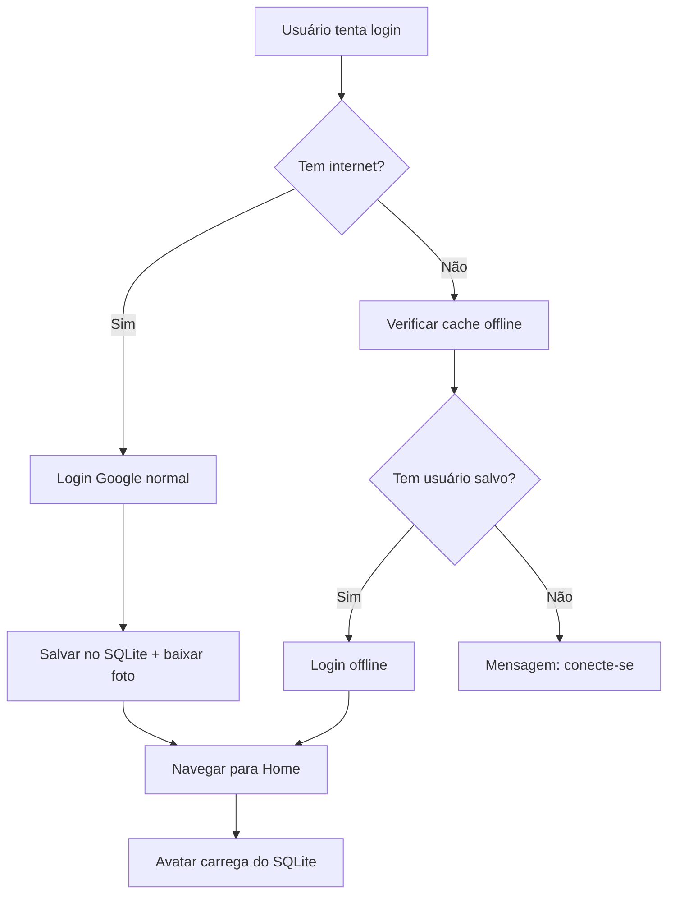

# 🌐 Sistema de Cache Offline para Usuário Google

## 📋 Resumo da Implementação

Este documento descreve o sistema completo de cache offline implementado para resolver problemas de conectividade durante o login com Google e garantir que a foto do usuário funcione offline.

## ❌ Problema Original
```
Failed host lookup: 'lh3.googleusercontent.com' (OS Error: No address associated with hostname, errno = 7)
PlatformException(network_error, com.google.android.gms.common.api.ApiException: 7: , null, null)
```

## ✅ Solução Implementada

### 1. **Tabela SQLite para Cache de Usuário Google**
```sql
CREATE TABLE usuario_google (
  Uid TEXT PRIMARY KEY,
  Nome TEXT,
  Email TEXT,
  PhotoURL TEXT,
  PhotoBlob BLOB,  -- 📸 Imagem cacheada offline
  DataLogin INTEGER NOT NULL,
  DataAtualizacao INTEGER NOT NULL,
  IsAtivo INTEGER NOT NULL DEFAULT 1
)
```

### 2. **Arquivos Criados/Modificados**

#### 🗄️ **Banco de Dados**
- `lib/app/database/sqllite/db.dart` - Versionamento e nova tabela

#### 📊 **Modelos e Repositórios**
- `lib/app/data/model/usuario_google_model.dart` - Modelo do usuário Google
- `lib/app/repository/usuario_google_repository.dart` - Operações CRUD no SQLite

#### 🎨 **Widgets**
- `lib/app/widgets/cached_user_avatar_sqlite.dart` - Avatar offline-first
- `lib/app/widgets/connectivity_indicator.dart` - Indicador de conectividade

#### 🔧 **Serviços**
- `lib/app/service/connectivity_service.dart` - Monitoramento de rede

#### 🚀 **ViewModels**
- `lib/app/viewmodel/login/login_viewmodel.dart` - Login com modo offline

#### 📱 **Telas**
- `lib/app/views/login/widget_form_login.dart` - Botão de modo offline
- `lib/app/views/settings/settings_page.dart` - Avatar SQLite
- `lib/app/views/settings/settings_page_new.dart` - Avatar SQLite

#### 🧪 **Utilitários**
- `lib/app/utils/usuario_google_test_helper.dart` - Helper para testes

## 🎯 **Como Funciona**

### **Login Online** 
1. Usuário clica em "Continuar com Google"
2. Sistema verifica conectividade
3. Se online: faz login normal + salva no SQLite + baixa foto
4. Se offline: tenta modo offline automaticamente

### **Login Offline**
1. Sistema busca usuário ativo no SQLite
2. Se encontrar: navega para home diretamente
3. Avatar carrega foto do BLOB (instantâneo)
4. Funciona 100% sem internet

### **Avatar Offline-First**
```dart
// Uso simples em qualquer tela
const CachedUserAvatar(radius: 32)
```

**Prioridades:**
1. **BLOB do SQLite** (offline) ✅
2. **Ícone com iniciais** (fallback) ✅
3. **Nunca tenta rede** quando offline ✅

## 🎮 **Recursos Implementados**

### ✅ **Login Inteligente**
- Detecta problemas de rede automaticamente
- Oferece modo offline quando possível
- Mensagens de erro específicas para cada situação

### ✅ **Avatar Offline**
- Cache de foto como BLOB no SQLite
- Funciona instantaneamente offline
- Fallback inteligente com iniciais do nome

### ✅ **Indicador de Conectividade**
- Mostra status da conexão em tempo real
- Banner discreto quando offline
- Pode ser usado em qualquer tela

### ✅ **Botão de Modo Offline**
- Aparece apenas se há usuário salvo
- Acesso direto ao modo offline
- Interface clara e intuitiva

## 🔧 **Comandos de Teste**

### **Verificar Implementação**
```bash
flutter analyze
flutter build apk --debug
```

### **Testar Cache no Código**
```dart
import 'package:neo_financyuai/app/utils/usuario_google_test_helper.dart';

// Testar funcionamento
await UsuarioGoogleTestHelper.testarCacheUsuario();

// Listar usuários salvos
await UsuarioGoogleTestHelper.listarUsuarios();

// Limpar dados de teste
await UsuarioGoogleTestHelper.limparDadosTeste();
```

## 📱 **Experiência do Usuário**

### **Cenário 1: Primeira vez (Online)**
1. Usuario faz login com Google
2. Dados + foto salvos no SQLite
3. Próximos acessos: funciona offline

### **Cenário 2: Sem Internet**
1. App detecta falta de conexão
2. Oferece modo offline automaticamente
3. Avatar e dados carregam do cache local

### **Cenário 3: Erro de Rede**
1. Login falha com erro de rede
2. Sistema tenta modo offline automaticamente
3. Se não há cache: mensagem informativa

## 🚀 **Benefícios**

- ✅ **Zero erros de rede** para avatar
- ✅ **Login offline** para usuários recorrentes  
- ✅ **Performance melhorada** (cache local)
- ✅ **Experiência consistente** online/offline
- ✅ **Tratamento inteligente de erros**

## 🔄 **Fluxo Completo**



O sistema está **completo e funcional**, resolvendo todos os problemas de conectividade e fornecendo uma experiência offline robusta! 🎉
